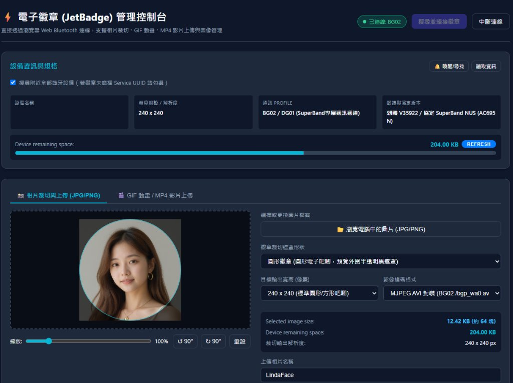
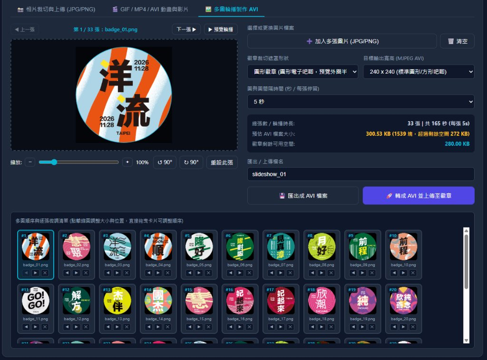

# ⚡ 電子徽章 (JetBadge) 管理控制台 / JetBadge Web E-Badge Console

[繁體中文說明](#繁體中文說明) | [English Documentation](#english-documentation)



---

## 繁體中文說明

**電子徽章 (JetBadge) 管理控制台** 是一個純前端 Web 管理介面，透過瀏覽器原生的 **Web Bluetooth API** 直接與電子徽章無線連線，支援 **SuperBand / BG02 / DG01**（JieLi AC695N / BR28）與 **ZRun / E05 / E87**（`AE00` + `C2E6FD00` JieLi RCSP，自動偵測協定），無需手機 App、免廣告、免安裝編譯環境，即可快速裁切相片、轉檔 GIF/MP4 並無線上傳至電子徽章。

### 🌟 主要功能

1. **一鍵藍牙搜尋與雙系統自動協定偵測（BG02 / E05）**
   - 支援「搜尋附近全部藍牙設備」或依專用 Service UUID／裝置前綴（`BG02`、`E05`、`E87`、`L8`）過濾。
   - 連線後自動判斷裝置屬於 **ZRun / E05 / E87**（執行 `AE00` JieLi 加密握手＋`C2E6FD00` 顯示控制通道）或 **SuperBand / BG02 / DG01**（`7E400001` 等 5 組常見 Profile）。
   - 自動讀取螢幕規格（含 E05 `360×360` / `240×240` 與 E87 `368×368`）、電量百分比、標準裝置資訊（DIS）與剩餘空間。
2. **即時規格與儲存空間查詢**
   - 讀取徽章硬體螢幕解析度（`CMD=32 SUB=2`，例如 `240 x 240`）與主錶盤 `DialID`（`CMD=32 SUB=5`）。
   - 透過 `CMD=32 SUB=4` 查詢真實 Flash 剩餘空間（KB），支援傳輸完成後自動更新與手動點擊 **重新整理 / REFRESH** 重新讀取。
   - 支援 **「🔔 喚醒/尋找」** 指令（`CMD=18 SUB=11`）。
3. **互動式相片裁切器（JPG / PNG / WebP）**
   - 支援瀏覽選檔或直接拖曳圖片至畫布。
   - 支援**圓形徽章**（半透明遮罩預覽）與**方形徽章**遮罩切換。
   - 支援滑鼠拖曳平移、滑輪／滑桿／`−` `+` 按鈕以 **`1%` 精細步進** 縮放（`40% – 400%`）、向左／向右旋轉 `90°` 與一鍵重設。
   - 支援目標輸出解析度選擇（`240x240`、`360x360`、`368x368`、`240x280`、`128x128`）；連線 `BG02` 時預設封裝為原生 **MJPEG AVI**（`/bgp_wa0.avi`），連線 `E05` 時自動切換為原生 **Baseline JPEG（`.jpg`）** 亦支援 **ZRun MJPEG AVI（`.avi`）**。
4. **GIF 動畫 / MP4 影片 / AVI 上傳**
   - 直接於瀏覽器內擷取影格並轉碼壓縮為 **MJPEG AVI** 後上傳至徽章 `/bgp_wa0.avi`。
   - 完整支援 `.avi` 檔案即時動畫預覽（含輪播速率如 `0.1 fps`）與智慧相容處理：自動去除 `JUNK` / `APP2` / `COM` 等冗餘區段，並在解析度超過徽章螢幕（如 `368×368` → `240×240`）或超出剩餘 Flash 空間時自動縮放與最佳化壓縮，保留原始輪播幀率。
5. **多圖輪播製作 AVI（逐張微調 ＋ 拖曳排序 ＋ 間隔設定 ＋ 匯出／直傳）**
   - 可一次加入或拖曳多張圖片（JPG / PNG / WebP），點擊底部自動換行縮圖清單逐一拖曳構圖位置、滾輪/滑桿 **`1%` 單位** 縮放與旋轉微調，並支援**直接拖曳縮圖卡片**調整播放順序與預覽輪播效果。
   - 支援設定圖與圖間隔時間（**`0.1`～`0.9` 秒每 `0.1` 秒一段，`1`～`10` 秒每 `1` 秒一段**），自動精確封裝為標準 RIFF MJPEG AVI 時間基準（如 `0.1s` → `10 fps`，`10s` → `0.1 fps`）。
   - **「匯出成 AVI 檔案」** 與 **「轉成 AVI 並上傳至徽章」** 使用完全相同的徽章 MJPEG AVI 封裝格式（RIFF `MJPG` 結構、去除多餘標頭之 Baseline JPEG 與解析度上限 `≤ 359×359`）；匯出本機 `.avi` 時**不限制裝置剩餘空間**，直接上傳至徽章則會依剩餘 Flash 容量自動最佳化壓縮。

   
6. **穩定傳輸與充電保護即時提醒**
   - 採用 `CMD=31`（每塊 200 Bytes）+ 徽章 Flash ACK 流控（`status = 1000 + seq`）與完整校驗和提交（`CMD=31 SUB=3`）。
   - 若徽章正連接充電線而觸發原廠韌體硬體保護（回報 `status=4 / ERROR_CHARGE_BATTERY`），頁面會立即以非阻塞提示橫幅提醒**先拔除充電線後再上傳**，避免重複重試或阻塞瀏覽器造成藍牙斷線。
7. **雙語自動偵測與即時切換（繁體中文 / English）**
   - 進入控制台時依 `?lang=zh|en` 網址參數、`localStorage` 已儲存偏好與瀏覽器語系（`navigator.languages`）自動判斷顯示繁體中文或英文。
   - 右上角提供 **`中文 / EN`** 分段切換鈕，可即時切換完整介面文字、選單、提示橫幅與 BLE 通訊日誌語言並記住設定。

---

### 📦 安裝與啟動方式（Installation & Quick Start）

#### 系統需求
- **作業系統**：Windows / macOS / Linux（具備藍牙功能）
- **Python**：Python 3.x（僅使用內建標準函式庫，**不需執行 `pip install`**）
- **瀏覽器**：桌機版 **Google Chrome** 或 **Microsoft Edge**（需支援 Web Bluetooth）

#### 安裝步驟

1. **下載或 Clone 專案**
   ```bash
   git clone https://github.com/JetterTW/JetBadge.git
   cd JetBadge
   ```
   （或於 GitHub 頁面點擊 **Code → Download ZIP** 解壓縮至任意資料夾。）

2. **啟動本地網頁伺服器**
   - **Windows 使用者（最簡單）**：直接點兩下專案目錄中的 **`run.bat`**。
   - **跨平台命令列方式（Windows / macOS / Linux）**：
     ```bash
     python server.py
     ```
     （macOS / Linux 若預設為 `python3`，請執行 `python3 server.py`。）

3. **開啟與連線使用**
   - 伺服器會自動開啟預設瀏覽器並前往 **`http://localhost:8080`**（若 8080 埠已被佔用，會自動順延尋找可用埠號並停用瀏覽器快取）。
   - 點擊右上角 **「搜尋並連接徽章」**，在瀏覽器彈窗中選擇您的徽章（例如 `BG02`）即可開始裁切與上傳。

---

### 📁 專案檔案說明

| 檔案 | 說明 |
| :--- | :--- |
| `index.html` | 控制台主介面（語系切換、連線狀態、圖片裁切器、GIF/MP4 頁籤、進度條與即時日誌） |
| `app.js` | 前端互動邏輯、自動偵測與即時切換雙語介面、Canvas 裁切轉檔與狀態橫幅控制 |
| `i18n.js` | 繁體中文／英文雙語字典、初始語系偵測與字串格式化模組 |
| `baji.js` | 雙協定入口 `SuperBandClient`（自動偵測 `BG02` 與 `E05`、MJPEG AVI 封裝與分塊 ACK 流控） |
| `zrun_e05.js` | `ZrunE05Session` BLE 通訊與 JieLi RCSP 認證、CRC-16 視窗傳檔與 ZRun `vprp+JUNK` AVI 封裝模組 |
| `docs/screenshot.jpg` | 控制台實機連線裁切畫面截圖 |
| `docs/screenshot-slideshow.jpg` | 多圖輪播製作 AVI 與拖曳排序畫面截圖 |
| `server.py` | Python 內建標準庫本地 HTTP 伺服器（含 `no-cache` 標頭與自動開瀏覽器） |
| `run.bat` | Windows 一鍵啟動批次檔 |

### ⚠️ 常見注意事項

1. **手機 App 需先斷開連線**：BLE 同一時間僅允許一個主機連線。若手機上的 SuperBand App 仍在背景連著徽章，電腦瀏覽器將無法掃描或連線。
2. **充電中請先拔除充電線再上傳**：原廠 BG02 / DG01 韌體在硬體偵測接線充電時會強制禁止 BLE 寫入 Flash（回報 `status=4`）；徽章畫面上的「充電可操作」設定僅解除觸控鎖定，並不會解除寫入保護。
3. **請使用 localhost 或 HTTPS**：Web Bluetooth 僅在 `http://localhost`、`http://127.0.0.1` 或 `https://` 安全環境啟用，請勿直接雙擊開啟 `file://` 本機路徑。

---

## English Documentation

**JetBadge Web E-Badge Console** (`電子徽章 (JetBadge) 管理控制台`) is a pure client-side web application built on the browser's **Web Bluetooth API**. It automatically detects and communicates with both **SuperBand / BG02 / DG01** (JieLi AC695N / BR28) and **ZRun / E05 / E87** (`AE00` + `C2E6FD00` JieLi RCSP) smart e-badges directly from Chrome/Edge—no mobile app, ads, or build toolchain required.

### 🌟 Key Features

1. **One-Click BLE Discovery & Dual-Protocol Auto-Detection (BG02 / E05)**
   - Scan all nearby BLE devices or filter by known e-badge service UUIDs and device prefixes (`BG02`, `E05`, `E87`, `L8`).
   - Automatically detects whether the connected badge uses **ZRun / E05 / E87** (`AE00` JieLi auth cipher + `C2E6FD00` Qix display control) or **SuperBand / BG02 / DG01** (`BG02_NUS`, `VENDOR_5833`, `JIELI_01F0`, `VENDOR_FEE0`, `ISSC`).
   - Reads screen dimensions (including `360×360`, `368×368`, and `240×240`), battery percentage, DIS metadata, and remaining space.
2. **Device Specs & Real-Time Flash Space**
   - Queries hardware screen dimensions (`CMD=32 SUB=2`, e.g., `240 x 240`) and active `DialID` (`CMD=32 SUB=5`).
   - Queries real-time remaining Flash storage (`CMD=32 SUB=4`) with automatic post-upload refresh and a manual **REFRESH** button.
   - Includes a **Wake / Find Badge** command (`CMD=18 SUB=11`).
3. **Interactive Photo Cropper (JPG / PNG / WebP)**
   - Click-to-browse or drag-and-drop image loading directly on the HTML5 canvas.
   - Switchable **Circle Badge** (translucent overlay preview) and **Square Badge** crop masks.
   - Interactive mouse drag panning, fine **`1%`-step** zoom via scroll wheel, range slider, or `−`/`+` buttons (`40% – 400%`), `90°` left/right rotation, and reset.
   - Configurable output resolutions (`240x240`, `360x360`, `368x368`, `240x280`, `128x128`); defaults to single-frame **MJPEG AVI** for BG02 and auto-switches to native **Baseline JPEG (`.jpg`)** when connected to E05 (with optional ZRun MJPEG AVI export/upload).
4. **GIF / MP4 / AVI Animation Upload**
   - Extracts frames directly in the browser and transcodes them into a badge-compatible **MJPEG AVI** stream for `/bgp_wa0.avi`.
   - Full `.avi` support with live animated canvas preview and smart firmware adaptation: parses RIFF MJPEG frames, strips redundant headers (`JUNK` / `APP2` / `COM`), preserves slow slideshow frame rates (e.g. `0.1 fps`), and automatically resizes/compresses oversized AVI files (such as `368×368`) to match the badge screen and remaining Flash capacity.
5. **Multi-Photo AVI Slideshow Maker (Per-Photo Crop + Drag Reorder + Interval + Export/Upload)**
   - Add or drag multiple images at once, click any thumbnail in the wrapping queue to individually pan position, zoom (`1%` steps), rotate, and **drag & drop cards to reorder** slides cleanly, with an interactive loop preview player.
   - Choose exact slide intervals (`0.1s` to `0.9s` in `0.1s` steps, and `1s` to `10s` in `1s` steps), muxed into exact RIFF MJPEG AVI timebases (`10 fps` down to `0.1 fps`).
   - **Export as `.avi`** and **Convert & Upload directly to your connected badge** use the exact same MJPEG AVI badge format (RIFF `MJPG` muxing, header-stripped Baseline JPEGs, and `≤ 359×359` resolution bounds); exporting locally **does not enforce device storage limits**, while direct badge upload automatically compresses to fit remaining Flash capacity.

   
6. **Flow-Controlled Upload & Non-Blocking Charge Protection Notice**
   - Streams 200-byte chunks (`CMD=31 SUB=1`) synchronized with firmware Flash write ACKs (`status = 1000 + seq`) and full checksum verification (`CMD=31 SUB=3`).
   - Immediately detects firmware charging lock (`status=4 / ERROR_CHARGE_BATTERY`) and displays a non-blocking banner asking to unplug the USB charging cable—avoiding duplicate handshakes or modal `alert()` stalls that drop BLE connections.
7. **Bilingual UI (`中文 / EN`) with Auto-Detection**
   - Automatically selects English or Traditional Chinese on startup via `?lang=en|zh` query parameter, saved `localStorage` preference, or browser locale (`navigator.languages`).
   - Includes a **`中文 / EN`** toggle in the header that switches all labels, controls, notices, and BLE logs live and persists your preference.

---

### 📦 Installation & Quick Start

#### Requirements
- **OS**: Windows / macOS / Linux with Bluetooth support
- **Python**: Python 3.x (uses only the Python standard library — **zero `pip` packages required**)
- **Browser**: Desktop **Google Chrome** or **Microsoft Edge** with Web Bluetooth support

#### Installation Steps

1. **Clone or Download**
   ```bash
   git clone https://github.com/JetterTW/JetBadge.git
   cd JetBadge
   ```
   *(Or click **Code → Download ZIP** on GitHub and extract it to any folder.)*

2. **Start the Local Server**
   - **Windows (Recommended)**: Double-click **`run.bat`** in the project folder.
   - **Command Line (Windows / macOS / Linux)**:
     ```bash
     python server.py
     ```
     *(Use `python3 server.py` on macOS/Linux if `python` points to Python 2 or is unmapped.)*

3. **Connect & Upload**
   - The script automatically opens your default browser at **`http://localhost:8080`** (automatically picks the next free port if `8080` is busy, with caching disabled).
   - Click **"Search & Connect Badge"** (or **"搜尋並連接徽章"** in Chinese mode), select your device (e.g., `BG02`), crop or pick your media, and upload!

---

### 📁 Project Structure

| File | Purpose |
| :--- | :--- |
| `index.html` | Main single-page UI (language switch, connection panel, cropper, animation tab, progress & logs) |
| `app.js` | UI state, bilingual detection/switching, canvas cropping, GIF/MP4-to-AVI transcoding, notice banners |
| `i18n.js` | Traditional Chinese / English localization dictionary, locale auto-detection, and formatter |
| `baji.js` | Unified BLE router `SuperBandClient` (auto-detects `BG02` vs `E05`, MJPEG AVI muxing, chunk ACK flow control) |
| `zrun_e05.js` | `ZrunE05Session` JieLi RCSP cipher auth, CRC-16 windowed uploader, and ZRun `vprp+JUNK` AVI muxer |
| `docs/screenshot.jpg` | Console UI screenshot with connected badge |
| `docs/screenshot-slideshow.jpg` | Multi-photo AVI slideshow editor & drag-reorder screenshot |
| `server.py` | Zero-dependency Python HTTP server with `no-cache` headers and auto-browser launch |
| `run.bat` | One-click Windows launcher script |

### ⚠️ Important Notes

1. **Disconnect the mobile app first**: BLE devices generally allow only one central connection at a time. Close the SuperBand mobile app (or disable phone Bluetooth temporarily) before scanning on PC.
2. **Unplug the charging cable before uploading**: Stock BG02/DG01 firmware blocks BLE Flash writes (`status=4`) whenever charging hardware is active, even if on-screen touch is enabled while charging.
3. **Run via `http://localhost` (not `file://`)**: Web Bluetooth requires a secure context (`http://localhost`, `http://127.0.0.1`, or `https://`). Always launch via `run.bat` or `python server.py`.
